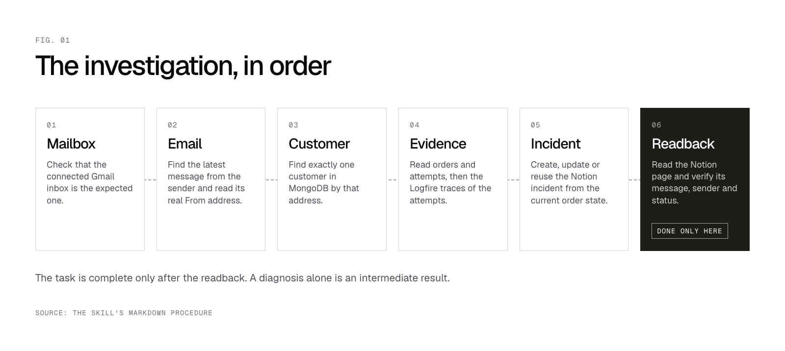
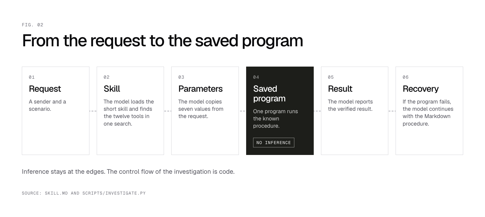
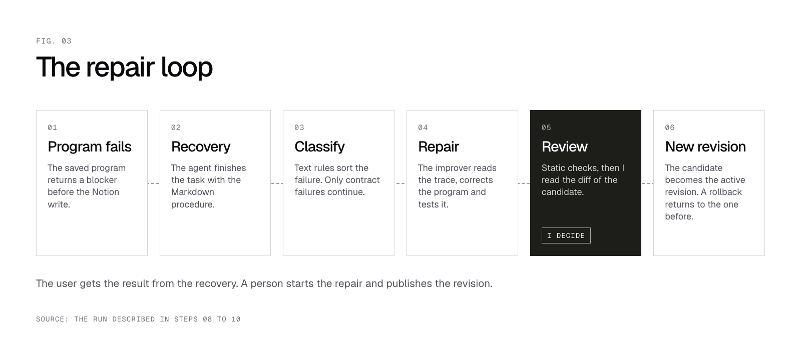

# Skill improvement cycle

A proof of concept that moves an agent skill from a Markdown procedure to a saved program, and then repairs that program when it fails.

The skill investigates order synchronization incidents: it finds a customer email in Gmail, the customer and their orders in MongoDB and the traces of the failed attempts in Logfire, then creates an incident in Notion and reads it back.



The repository shows three things, in order:

1. The agent follows the procedure in Markdown and calls the tools one at a time.
2. A second agent, the improver, writes one program that does the whole investigation. That program is saved inside the skill, and the first agent runs it and does not write it again.
3. When the saved program fails, the agent finishes the task with the Markdown procedure. The failure is recorded, the improver repairs the program from the trace, and a person approves the repair as a new revision of the skill.

This is a guide that you can follow to run the same loop on your own skill. It is not a production system: [Limits](#limits) lists what it needs first.



## Components

| Component | Purpose |
| --- | --- |
| Orders app | Generates synthetic orders, controlled failures and recovery |
| MongoDB | Stores customers, orders and synchronization attempts with native ObjectIds |
| Logfire | Receives the simulator traces and the agent traces, and exposes them through MCP |
| Gmail through Composio | Provides the incident email |
| Notion through Composio | Stores the investigation result |
| Investigator | The agent that runs the skill for a request |
| Script improver | The agent that writes and repairs the saved program |
| Skill registry | The revisions of the skill, the active one and the recorded failures |

The simulator uses PyMongo and Logfire directly. The agents use the full native MCP toolsets, loaded on demand. The investigation procedure lives in the skill, not in integration code.

## Quick start

You need Docker with Compose, uv, Python 3.13, Node 22.12+ and npm. Docker must be running.

```sh
make setup        # installs dependencies and creates the two .env files
# fill in orders-app/.env and investigation-agent/.env (see "Configuration")
make up           # starts the local MongoDB
make seed SCENARIO=demo
make check-mcp    # checks Logfire, Gmail, Notion and Mongo
make investigate SENDER=customer@example.com SCENARIO=demo
```

Before the last command, send an email from the customer address to the connected Gmail inbox. Replace `customer@example.com` with that address.

The commands do not print the diagnosis. Read the result, the model usage and every tool call in Logfire.

## Checkpoints

Each commit is a point where you can stop and run the project as it was at that step. Go to one with `git checkout` and its hash.

| Commit | What it contains |
| --- | --- |
| `fefde7f` | The orders simulator, the local MongoDB and the four MCP connections. There is no agent yet |
| `df1d5c4` | The 130-line Markdown skill and the agent. `make investigate` has the switch `CODE_MODE=0\|1`, so this is the place to compare direct tools with Code Mode |
| `1a68e7a` | The improver as a separate agent, with `make improve` |
| `9209c17` | The saved program, the short skill and the Markdown recovery. From here, `make investigate` always runs the saved program |
| `f6b87c0` | The skill registry, the failure detection, the repair command and the checks before activation. `r1` is intact and active, so this is the place to break the program and run the loop yourself |
| `de14167` | The state after one run of the loop: `r1` with a deliberate fault, `r2` active and the recorded failure |

**The latest code is in the state after one run of the loop.** Revision `r2` is active. Revision `r1` contains the fault that was introduced on purpose to test the repair, so `make skill-rollback` returns to a program that fails, and `make skill-activate REV=r2` reports that `r2` is not a candidate. Use this state to read the two revisions and the recorded failure side by side. To run the loop yourself, start from `f6b87c0`.

## Configuration

`make setup` installs the locked Python and Node dependencies and creates private `.env` files from the committed examples, only when they are missing. It does not start services or call external APIs. Run it again after you change checkpoint, because the commands of each checkpoint are installed by it.

Mongo runs on `127.0.0.1:27029`, in this repository's own Compose project and volume. The default application database is `skill_orders_demo`.

**In `orders-app/.env`:**

- `CUSTOMER_EMAIL`: the address from which you will send the incident email. Set it before you seed.
- `LOGFIRE_TOKEN`: a project write token. Seeding and recovery always send traces to Logfire and stop before they change orders if the token is missing.

**In `investigation-agent/.env`:**

- `LOGFIRE_API_KEY`: a Logfire API key with `project:read` access, for the Logfire MCP.
- `LOGFIRE_MCP_URL`: the MCP endpoint of your region. The example uses EU.
- `LOGFIRE_PROJECT`: the project that contains the simulator traces. The agent uses it in its queries.
- `LOGFIRE_TOKEN`: a write token of the same project, for the agents' own traces.
- `COMPOSIO_API_KEY`, `COMPOSIO_GMAIL_CONNECTED_ACCOUNT_ID` and `COMPOSIO_NOTION_CONNECTED_ACCOUNT_ID`: connect the Gmail inbox and the Notion workspace in Composio first. The key must allow reading connected accounts, creating tool-router sessions and executing tools.
- `GMAIL_ACCOUNT_EMAIL`: the receiving inbox.
- `NOTION_DATABASE_NAME`: the name of the incidents database. The default is `Incidents`.
- `OPENAI_API_KEY`, and optionally `MODEL`, `REASONING_EFFORT`, `IMPROVER_MODEL` and `IMPROVER_REASONING_EFFORT`.

Give the Notion connection access to a database with these properties:

| Property | Notion type |
| --- | --- |
| Incident | Title |
| Status | Select: Open, Investigating, Awaiting intervention, Resolved |
| Customer | Text |
| Email | Email |
| Gmail Message ID | Text |
| Created | Created time |

```sh
make check-mcp
# Or check just one service:
make check-mcp SERVICE=gmail
```

`make check-mcp` checks Logfire, Gmail, Notion and Mongo, and reports each result even if another connection fails. It exits unsuccessfully if any check fails. Use `SERVICE=logfire|gmail|notion|mongo` to select one service. The checks initialize MCP and list its tools; the Composio checks create an application-scoped session. They do not read email, execute application tools or write Notion pages. A successful tool listing proves connectivity, not that the investigation works.

Private credentials are ignored by Git. No credentials, connected-account IDs or private data are in this repository. The simulator and the connectivity checks need no model key.

## The orders simulator

```sh
make seed SCENARIO=demo
make recover SCENARIO=demo
make status
make down
```

The seed produces two customers, six orders and six attempts: three orders fail for Aster Labs because credential renewal is rejected, and the three orders of the control customer synchronize. Recovery retries the three failed orders and keeps their earlier attempts. Both commands send telemetry to Logfire and also show it in the console.

Seeding is idempotent: running a scenario again does not reset recovered orders or change the email of an existing customer. Use a new `SCENARIO` to create a fresh incident, or after you change `CUSTOMER_EMAIL`. `make down` keeps the data volume.

To start the scenario again:

```sh
make reset-orders
make seed
```

`reset-orders` clears the `orders` and `sync_attempts` collections across all scenarios in the configured database. It keeps customers, their ObjectIds, names and emails, all indexes and other collections. It resets only the connection fields of the demo customers: Aster returns to rejected credential renewal and Cedar stays healthy. This restores the failure scenario even after recovery. The command starts Mongo if needed, does not seed and needs no Logfire token. The next `seed` reuses the customers of the same scenario and creates fresh orders and attempts.

Other Mongo databases, Gmail messages, Notion incidents and earlier Logfire traces are not changed. Do not run seed, recovery or another database operation at the same time as a reset.

## The two agents

| Agent | Model setting (default) | Reasoning setting (default) | Deadline | Logfire service |
| --- | --- | --- | --- | --- |
| Investigator | `MODEL` (`openai:gpt-6-luna`) | `REASONING_EFFORT` (`low`) | 300 seconds | `orders-investigation-agent` |
| Script improver | `IMPROVER_MODEL` (`openai:gpt-6.1-sol`) | `IMPROVER_REASONING_EFFORT` (`high`) | 600 seconds | `investigation-script-improver` |

The two agents share `OPENAI_API_KEY`, the MCP credentials and the Logfire write token. `MODEL` affects only the investigator, and `IMPROVER_MODEL` only the improver. Every agent command accepts `--timeout`; the deadline covers the whole run, including the connection setup. After a timeout, look at Notion before you retry, because a write may have completed.

The commands do not print agent events, generated code, the final diagnosis or usage summaries. Logfire has the structured final result, the model usage, the generated programs, the tool events, the retries and the span durations. Agent tracing includes model and tool content, so use demo data. The simulator traces use the service name `orders-sync-demo`.

Differences between the two agents come from their models and objectives as well as from how they use Code Mode. One successful run validates only the path that it took.

## Run an investigation

```sh
make up
make investigate SENDER=customer@example.com SCENARIO=demo
```

Replace the sender with the seeded customer email and use the same scenario as `make seed`. Run investigations one after another, not at the same time.

The agent selects the latest inbox message from the sender, including read messages, identifies the customer in Mongo, reads the orders and the Logfire evidence, then creates or reuses the Notion incident and reads it back before it returns a diagnosis. There is no ledger of processed emails, so a repeated run investigates again. Notion deduplication uses the Gmail message ID and is a lookup, not an atomic uniqueness constraint. `make recover` changes the orders, and a later investigation then updates the existing incident from the current order state. Earlier failure traces alone do not mean that the incident is still open.

The investigator always uses Code Mode. It loads the short skill, finds the twelve MCP tools of the program in one search, copies the parameters of the request and runs the saved program in Monty. The skill gives it a short fixed invocation that reads the program from a read-only mount and calls its asynchronous entry point. The model supplies the parameters, not the program, and there is no custom tool to run the script.

The request provides the sender, the receiving mailbox, the scenario, the Mongo database, the Logfire project, the Notion database name and a fresh UTC timestamp. Collection names, Notion properties and statuses, and the `orders-sync-demo` service are contracts of this application, not parameters for an arbitrary workflow.

The skill also defines the recovery. If the tool search or the program fails, the model reads the original procedure with `read_file`, checks which effects really happened and continues the missing work with Code Mode. It verifies Notion before it reports success, and it reports any blocker that it cannot resolve. Python code does not select the fallback or run the program again. Neither a normal run nor a recovery changes the program in the registry.

`LocalWorkspace` and `FileSystem(read_only=True)` expose the active revision of the skill through native file tools. `CodeMode(mount=...)` exposes the same directory at `/skills` inside Monty. Only the skill files are mounted: there is no shell tool and no access to environment files. The short invocation is type-checked, but the program loaded with `exec` is parsed and executed at run time, so its errors appear during execution.

## Improve the investigation program

```sh
make improve SENDER=customer@example.com SCENARIO=demo
```

This starts the other agent, `investigation-script-improver`. It reads the Markdown procedure of the active revision, uses the same MCP tools, writes a program, runs it and corrects it from the errors of each run. Its objective is a complete, verified investigation in as few programs as practical, ideally one. Its instructions contain the rules about what Monty supports and how to chain the calls; the investigator does not have them.

**Improvement runs execute the real tools.** They read the selected email, Mongo and Logfire, and they can create or update its Notion incident. Run them one after another with investigations. The generated programs and tool events are recorded in Logfire. They are candidates for review, and the improver does not write them into the skill.

The program in revision `r1` came from the first successful run of the improver. Its literal inputs were replaced by injected parameters, and the code was wrapped in `async def run_investigation(params)` with an explicit return. Its control flow and its tool calls were kept. The trace of that run is not in the repository.

## The repair loop



The skill lives in a local registry, `investigation-agent/skill-registry/`. Each revision (`r1`, `r2`, ...) is a complete copy of the skill with a `revision.json`. The `active` file names the revision that the investigator mounts and runs.

```sh
make investigate SENDER=customer@example.com   # runs the active revision
make failures                                  # failures of the saved program
make improve-failure ID=f20300101-120000       # repair -> candidate revision
make skill-list
make skill-diff REV=r3                         # review the change
make skill-activate REV=r3                     # publish it
make skill-rollback                            # return to the previous revision
```

Use the failure ID that `make failures` prints and the revision name that `make improve-failure` prints.

1. **Detect.** After each investigation, the runner looks at the result of the saved program. A script error, a `blocker` or a `verification.complete` that is not true is recorded in `skill-registry/failures/`, with the revision, the Logfire trace ID and the request. The run itself is not changed: by then the Markdown recovery has finished the task. Failure records are local runtime data and Git ignores them. One record, with fictitious data, is committed as an example.
2. **Classify.** Text rules assign one class: `transient` (timeouts, rate limits and 5xx responses, which need no change), `needs_human` (business conditions such as an ambiguous customer or duplicate incidents, and any error that the rules do not know) or `contract` (runtime errors and tool responses with an unexpected shape). Only `contract` failures are repaired, unless you pass `--force`.
3. **Repair.** `improve-failure` runs the improver with the active program, the failure and its trace ID. The improver reads the trace through the Logfire MCP, corrects the program and tests it with the real tools on the request that failed. The same trace contains the Markdown recovery, which shows what works with the real data. **This run can write the Notion incident.** The registry saves the exact text that was tested and verified, as a candidate revision. The improver has no tool that can write to the registry.
4. **Check and approve.** A candidate can be activated only if it has a verified run and passes the static checks: one `async def run_investigation(params)` and nothing else at the top level, only the twelve tools of the skill, only the known imports, and no `yield`, `getattr`, `next`, `exec`, `eval` or `open`. Then a person reads `skill-diff` and runs `skill-activate`.
5. **Roll back.** `skill-rollback` activates again the revision that the active one replaced.

## Limits

This repository is a proof of concept. Before production, the loop needs at least these changes:

- **Regression tests.** There are no tests of the program against simulated MCP servers, so a candidate is tested only on the request that failed. The diff review and the rollback cover the other branches.
- **A better classification.** The classes come from text rules.
- **Repairs that start without a person.** A person starts each repair, one failure at a time, and the repair test writes to the real Notion database.
- **Detection of runs that return no result.** A run that times out or raises an exception before it returns records no failure.
- **More evidence.** All the runs used one email and one customer, and the repaired fault was introduced on purpose.

## Tests

```sh
make test
```

The tests need Docker for the local Mongo, and they do not call a model or an external service.

- **Simulator tests** use temporary databases and delete only those. They do not change the demo scenario or send telemetry.
- **Connection tests** use an in-memory HTTP transport to check the Composio account selection and the session requests.
- **Agent tests** use a fake model and an in-memory MCP server to check that both agents load the skill, read the procedure and call native tools through Monty.
- **Loop tests** cover the failure detection, the classification, the static checks, the creation of a candidate, the activation and the rollback, in a temporary registry. They do not run `investigate.py` against simulated Gmail or Notion.

## Repository layout

```text
orders-app/                         Simulator, its tests and Python lockfile
investigation-agent/
  src/skill_improve_cycle/
    common/
      capabilities/                 Native MCP toolsets
      integrations/                 Composio sessions
      composition.py                Skill and toolset composition
      registry.py                   Skill revisions, activation and rollback
      failures.py                   Failure detection, classification and queue
      checks.py                     Static checks for candidate programs
      skill_cli.py                  Revision and failure commands
      runtime.py                    Input preparation and MCP setup
      command_support.py            CLI and telemetry primitives
      connections.py                MCP connectivity checks
      models.py                     Shared input and diagnosis
      paths.py                      Project root and Node server location
    investigator/
      agent.py
      runner.py                     Runs the active revision, records failures
      cli.py
    improver/
      agent.py
      runner.py
      cli.py
      repair.py                     Repair from a recorded failure
  skill-registry/
    active                          Name of the active revision (r2)
    revisions/
      r1/                           First saved program, with the deliberate fault
      r2/                           The repaired program
        revision.json               Status, base, reason, traces, checks
        investigate-incident/
          SKILL.md                  Short invocation instructions
          references/direct-procedure.md  Original Markdown procedure
          scripts/investigate.py    Parameterized Monty program
    failures/                       Recorded failures; one example is committed
  tests/                            Agent, connection and loop tests
  mcp/mongodb/                      Official Node MCP server and lockfile
docs/images/                        Figures of this README
compose.yaml                        Local MongoDB
Makefile                            Setup, simulator, agent and registry commands
```
